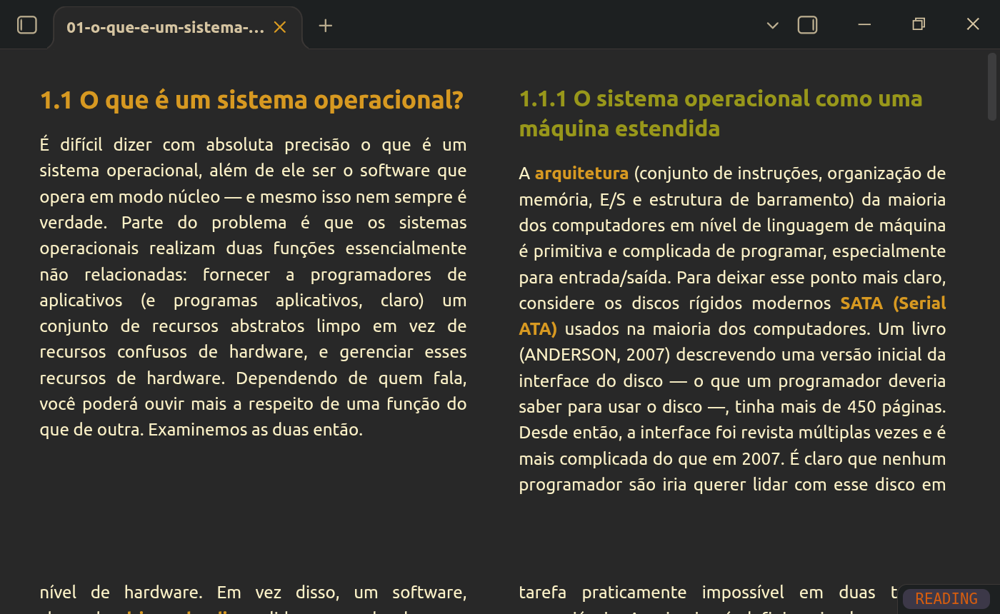

# Colunas fixas

Read long notes like a book: reading view is laid out in columns as tall as the pane. Text fills the left column, then the next ones, and continues on the "screen" below, so scrolling one pane height moves you to a fresh set of columns.



## Features

- Screen-height columns in reading view (live preview and source mode are not affected).
- The layout stays put while you scroll (see [How it works](#how-it-works)).
- Headings are kept with the paragraph that follows them; images, code blocks and tables are never split between columns, and images taller than a column are scaled down to fit.
- **Settings → Colunas fixas**: number of columns (1–4), column gap and vertical margin.
- Command **Colunas fixas: Toggle columns in reading view**, to switch the layout on and off without disabling the plugin.

## Requirements

The layout relies on the CSS properties `column-height` and `column-wrap`, available since Chromium 145. Obsidian's Chromium version comes from the **installer**, not from the app update, so an old installation may not support them even on a recent Obsidian version. In that case the plugin shows a notice and does nothing; download the latest installer from [obsidian.md](https://obsidian.md/download) to fix it.

On mobile, it works only where the system web view supports these properties (recent Android WebView; not iOS at the time of writing).

## How it works

Obsidian's reading view only renders the sections near the visible area and swaps them while you scroll. With columns, each swap reflows the whole page and the text jumps around. The plugin makes the reading view renderer pre-render the entire note, so the layout is computed once.

This uses two fields of Obsidian's internal renderer (`renderExtra` and `renderExtraMinPx`), which are not part of the public API. The plugin checks that they exist before touching them, stores their original values and restores them when the layout is switched off or the plugin is disabled. If a future Obsidian version changes these internals, the columns still work but may reflow while scrolling.

Rendering the entire note at once can be slow for very long notes.

## Installation

From Obsidian: **Settings → Community plugins → Browse**, search for "Colunas fixas".

Manually: download `main.js`, `manifest.json` and `styles.css` from the [latest release](https://github.com/rillmind/obsidian-colunas-fixas/releases/latest) into `<vault>/.obsidian/plugins/colunas-fixas/`, reload Obsidian and enable the plugin.

## Development

```sh
npm install
npm run dev     # rebuilds main.js on change
npm run build   # type check + production build
npm run lint
```

To release, run `npm version <patch|minor|major>` (updates `manifest.json` and `versions.json`) and push the tag; the release workflow builds the plugin and creates a draft release.

## License

[MIT](LICENSE)
